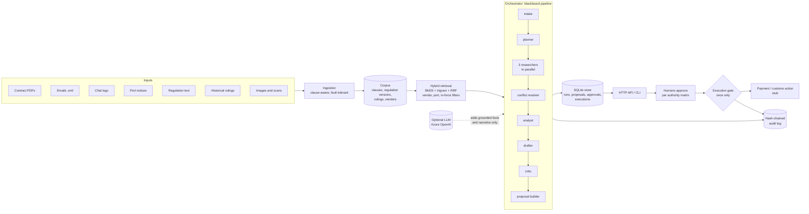
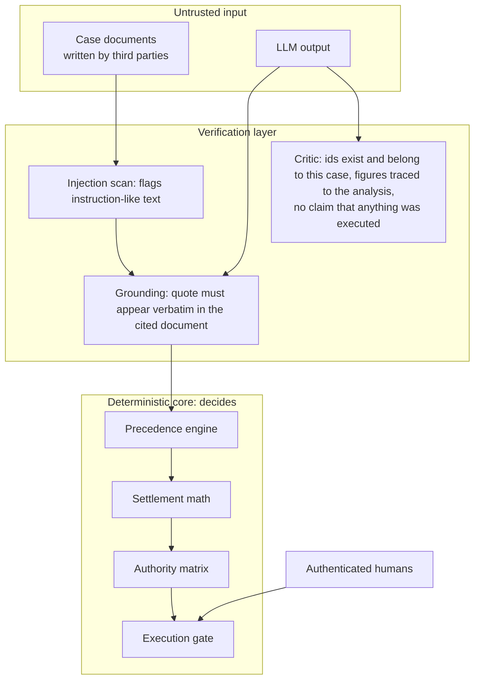
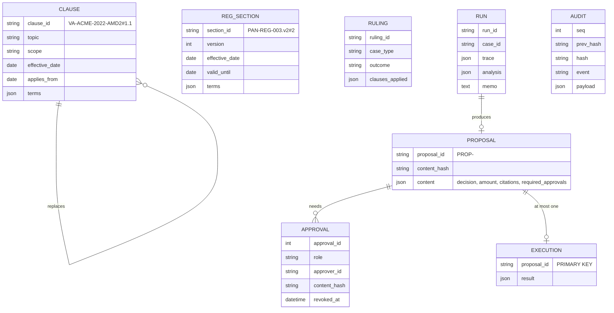
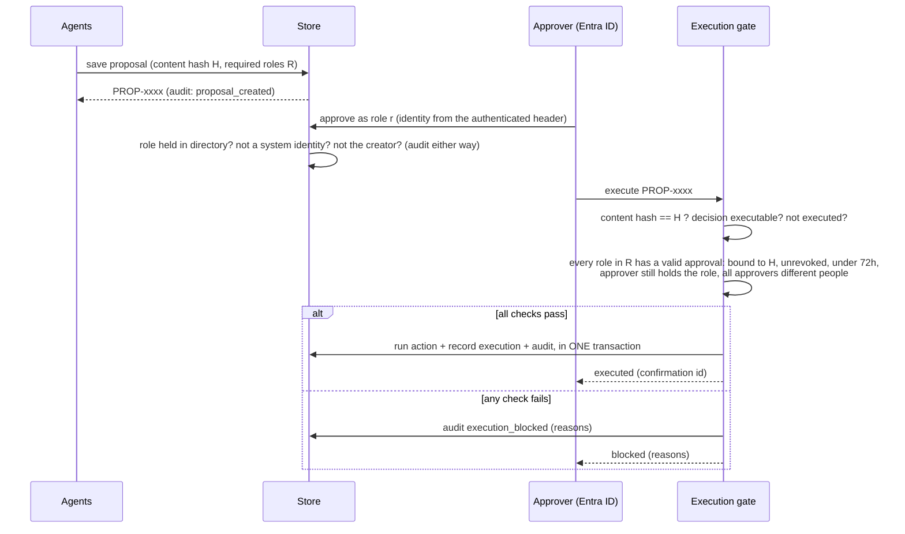

# Architecture

## 1. Components

## 2. The pipeline and what each stage owns

| Stage | Kind | Reads | Writes | Notes |
|---|---|---|---|---|
| `intake` | critical | case folder | `case`, `facts` | Deterministic extraction is the baseline; an LLM may add events that pass grounding checks |
| `planner` | critical | `case`, `facts` | `plan` | Chooses topics and queries from the case type, the vendor's documents, and detected issues |
| `clause_researcher` | non-critical | `case`, `plan` | `retrieved.clauses`, gaps | Repair loop: plain query, then synonym expansion, then bare topic, then a reported gap |
| `regulation_researcher` | non-critical | `case`, `facts`, `plan` | `retrieved.regulations` | Only the version **in force on the incident date**; reports what it excluded and why |
| `precedent_researcher` | non-critical | `case`, `plan` | `retrieved.rulings` | Similar past rulings, vendor boost, lexical-overlap floor (no filler precedents) |
| `conflict_resolver` | critical | clauses | `topic_rulings` | Expands the set along "replaces" links, then applies the precedence rules |
| `analyst` | critical | everything above | `analysis` | Checks, payout math, decision, blockers, reasoning chain |
| `drafter` | critical | `analysis` | `memo` | Deterministic memo; optional LLM narrative, verified |
| `critic` | critical | `analysis`, `memo` | `memo_meta` | Independent review; drops an LLM narrative that fails |
| `proposal_builder` | | `analysis`, `memo` | `proposal` | Refuses invented citations, stale regulations, mismatched amounts |

The three researchers run concurrently and cannot read each other's output (a test enforces it). Each agent declares `reads` and
`writes`; `tests/test_agents.py::TestWiring` proves every read is produced by an earlier stage.

## 3. Trust boundaries

Nothing in the untrusted boxes can reach the decision logic except as a *fact that has passed a check*. The model has no
tools and no side effects. A planted instruction in an email (CASE-1004) is flagged, treated as data, and *adds* a reviewer.

## 4. Data model

* A **clause id** is the document id plus the clause number as printed in the PDF, so a reviewer can find it on the page.
* The **proposal id** is derived from the SHA-256 of the proposal content. Identical content gives the identical id; any edit gives a
  different one and voids earlier approvals.
* `EXECUTION.proposal_id` is the primary key: at most one execution per proposal, even under races.

## 5. Approval and execution

Authority matrix (USD): settlement up to 10,000 needs a logistics coordinator; up to 100,000 an underwriter; above that a senior
underwriter **and** legal counsel; denial needs an underwriter; customs release needs a compliance officer. Risk flags
(`injection_suspected`, `material_discrepancy`) **add** legal counsel and can never remove a reviewer.

## 6. Failure handling

| Failure | Result |
|---|---|
| Unknown or malformed case | Run **fails**; nothing proposed; `run_failed` audited |
| A researcher crashes or times out | Recorded as a gap; the analyst escalates to legal; a precedent failure only loses precedents |
| A required clause topic cannot be found | Reformulate twice, then a reported gap and escalation |
| A vendor agreement exists but is unreadable | `request_information`; the master agreement is not assumed to apply |
| Two equally authoritative clauses conflict | `escalate_to_legal`; no payout computed |
| A critical agent raises, the critic rejects the memo, or the proposal builder refuses | **Safe escalation**: a non-executable proposal to legal counsel with the reason |
| LLM down, malformed, hallucinating, or malicious | Retried with backoff, then the deterministic path; the circuit breaker stops hammering a failing provider |
| Execution action fails | Nothing is recorded as executed; the failure is audited; retry is safe |
| Two execute requests race | One wins; the other returns the stored result (`idempotent_replay`) |
